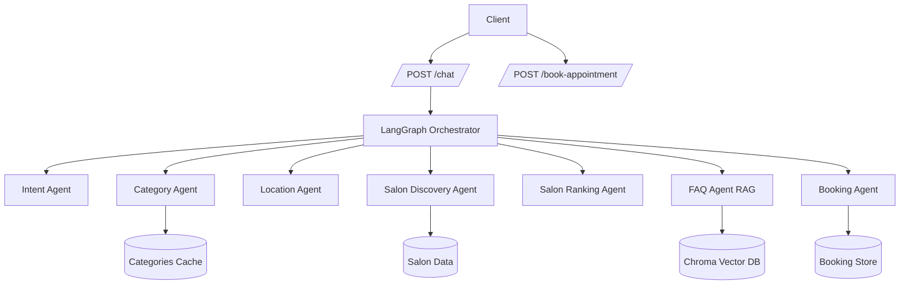
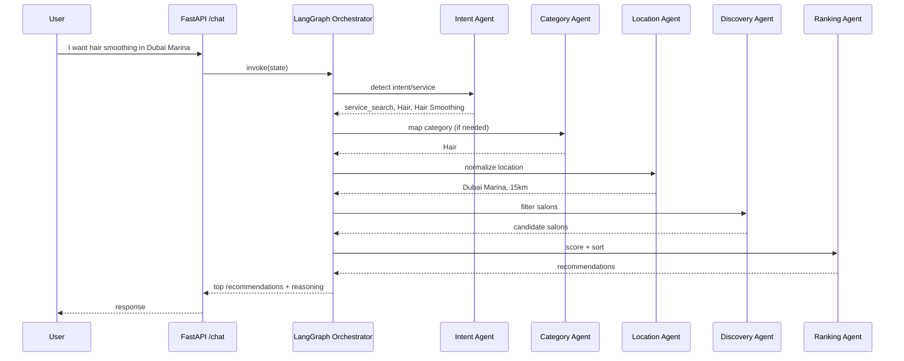
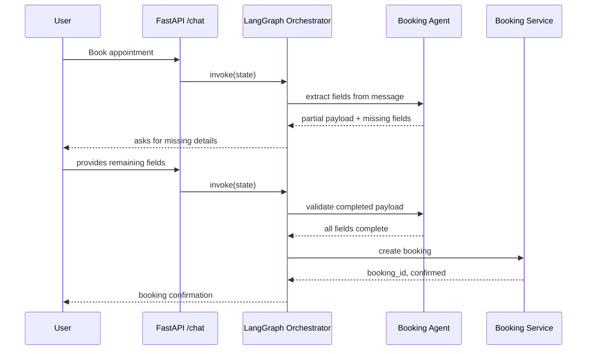

# BOOKLY AI Appointment Agent

Local FastAPI + RAG-based assistant for salon booking.

Installation

```bash
python -m venv .venv
source .venv/bin/activate  # or .venv\Scripts\activate on Windows
pip install -r requirements.txt
```

Environment

Copy `.env.example` to `.env` and set `OPENAI_API_KEY`.

Run

```bash
uvicorn app.main:app --reload
```

Swagger: http://127.0.0.1:8000/docs

Testing

```bash
pytest -q
```

RAG Evaluation

```bash
python -m app.rag.evaluation
```

This generates `rag_evaluation_report.json` with retrieval and chat performance metrics.

# Bookly AI Appointment Booking Chatbot

Production-ready, modular chatbot backend for salon discovery and appointment booking using FastAPI, LangGraph, LangChain, OpenAI, and ChromaDB.

## Features

- Multi-agent orchestration with LangGraph
- Intent detection (FAQ, policy, service search, booking, cancellation, general)
- Category mapping and dynamic system prompt with cached categories
- Location analysis and normalized search radius
- Salon discovery and AI ranking engine
- Appointment booking flow with slot-filling across multi-turn conversations
- RAG for FAQ and policies (OpenAI embeddings + Chroma)
- Structured APIs, validation, logging, and error handling

## Tech Stack

- Python 3.12
- FastAPI
- LangGraph
- LangChain
- OpenAI
- ChromaDB
- Pydantic
- Uvicorn

## Project Structure

```text
app/
  api/
    routes/
  agents/
  core/
  data/
  graph/
  memory/
  models/
  prompts/
  rag/
    documents/
  services/
  utils/
```

## Architecture Diagram



## Sequence Diagram: Salon Discovery



## Sequence Diagram: Booking Flow



## API Endpoints

- `POST /chat`
- `POST /book-appointment`
- `GET /categories`
- `GET /health`

### Sample Request: Chat

```json
{
  "session_id": "session-123",
  "message": "I want hair smoothing in Dubai Marina"
}
```

### Sample Request: Book Appointment

```json
{
  "session_id": "session-123",
  "customer_name": "Sara Khan",
  "phone": "+971501234567",
  "salon": "Marina Luxe Salon",
  "service": "Hair Smoothing",
  "date": "2026-06-15",
  "time": "18:30"
}
```

## Setup

1. Create and activate Python 3.12 virtual environment.
2. Install dependencies:
   `pip install -r requirements.txt`
3. Copy environment file:
   `copy .env.example .env`
4. Set `OPENAI_API_KEY` in `.env`.
5. Start server:
   `uvicorn app.main:app --reload --port 8000`

## Business Flow Coverage

- Step 1: Categories fetched on startup and cached.
- Step 2: Dynamic prompt generated from cached categories.
- Step 3-5: Intent + category extraction and mapping.
- Step 6-7: Missing location prompt + location analysis.
- Step 8-10: Discovery, ranking formula, recommendation response.
- Step 11: Booking slot-filling and persisted confirmation.
- Step 12: RAG pipeline with local docs and Chroma.

## Ranking Formula

Score computed as:

- 40% Service Match
- 30% Distance
- 20% Rating
- 10% Availability

Implemented in `app/services/ranking_service.py`.

## Caching Strategy

- Categories API result is cached in in-memory TTL cache.
- TTL controlled by `CATEGORIES_CACHE_TTL_SECONDS`.
- Warmup fetch runs during app startup.

## Error Handling and Logging

- Global exception handler returns structured 500 response.
- Upstream HTTP requests use retries (tenacity).
- Request timing middleware adds `X-Response-Time-ms` header.
- Structured application logging configured in `app/core/logging.py`.

## Deployment

See `docs/DEPLOYMENT.md` for production deployment patterns.
