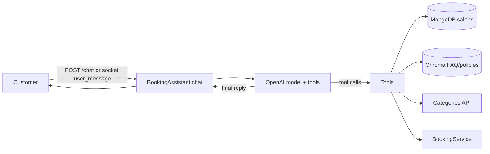

# Bookly AI Appointment Agent

FastAPI + Socket.IO backend for Bookly's salon assistant. Customers chat to discover salons, book
appointments and ask about Bookly; an OpenAI model with tools drives the whole conversation.

## Run

```bash
python -m venv .venv && source .venv/bin/activate
pip install -r requirements.txt
cp .env.example .env          # set OPENAI_API_KEY (and MONGODB_URI for real salon data)
uvicorn app.main:app --reload --port 8000
```

Swagger: http://127.0.0.1:8000/docs · Tests: `pytest -q` · Rebuild knowledge base: `python -m app.rag.ingest`

## How a message is handled



1. `app/agent/assistant.py` builds the system prompt with today's date and the live session state
   (booking draft, salons already seen, whether a summary awaits confirmation).
2. The model reads the message in context and decides what to do: answer, ask a question, or call tools.
   There is **no keyword/regex intent detection**: paraphrases, topic switches and mid-booking questions
   are all understood by the model.
3. Tool results go back to the model until it replies in text (max 6 rounds).
4. The reply, salon cards (from `search_salons`) and booking result are returned to REST/socket clients.

**Division of labour:** the model *understands* (intent, entities, dates like "tomorrow 4pm");
the tools *enforce rules* that must never depend on model judgement.

## Tools (`app/agent/tools.py`)

| Tool | What it does | Why / when the model uses it |
|------|--------------|------------------------------|
| `list_service_categories` | Returns live categories from the Categories API (MongoDB fallback). | Customer asks what services exist. Categories are never listed from memory. |
| `list_services` | Services offered in a category (price range, number of salons), optionally per location. | The customer names a category ("Hair Removal") instead of a service: show its services and ask which one. |
| `search_salons` | Finds active salons by location, service and/or salon name; returns id, name, address, rating and each salon's exact services. Results become salon cards. | Finding salons, a customer naming a salon, or a service/location change. A salon must come from here before it can be booked. |
| `search_knowledge_base` | Retrieves passages from `app/rag/documents/*.md` (FAQ, policies). | Any question about Bookly, payments, cancellation, refunds, privacy. Answers are grounded in these passages only. |
| `check_availability` | A salon's opening hours on a date and the window still bookable (2-hour advance rule). | Before proposing a time, when asked when a salon is open, or after a time is rejected. Shown as a range, never as slots. |
| `get_my_bookings` | The signed-in customer's past app bookings (salon, services, date, time, status, own rating), recent chatbot requests, and a recommended salon. | Rebooking, "my previous haircuts", or a service they had before (scenarios 1 & 3). |
| `update_booking` | Sets/changes service, salon, date (YYYY-MM-DD), time (HH:MM) on the draft and validates it. | Whenever the customer gives or changes a booking detail, including mid-conversation. |
| `confirm_booking` | Writes a **booking request** (status `pending`) to the `booking` collection. | Only after the customer explicitly agrees to the summary shown in an earlier message. |
| `get_booking_request` | Fetches an existing request by ID (e.g. `BKLY-09102026-004`): salon, service, date, time, status, whether it can be modified/cancelled. | The customer gives a request ID or asks about an existing request. |
| `modify_booking_request` | Loads a pending request into the booking draft; after `update_booking` + confirmation, `confirm_booking` saves the changes **on the same request ID**, keeping `previousRequestedDate/Time`, `rescheduledAt`, `previousServiceId/Name`, `serviceModifiedAt`. | Rescheduling or changing the service of a request. The salon cannot change. |
| `cancel_booking_request` | Sets `status`/`bookingStatus` to `cancelled` with `cancelReason`, `cancelledAt`. | Only after the request was shown in an earlier message and the customer confirmed. |
| `reset_booking` | Clears the draft. | Customer abandons or restarts the booking. |

### Booking rules enforced in code
- The salon must have been returned by `search_salons` in this session.
- The salon must offer the service (case-insensitive match against its service list), so switching
  to a service the salon does not offer is rejected with the list of services it does offer.
- Date/time must be valid and not in the past (`APP_TIMEZONE`, default `Asia/Dubai`).
- The time must be inside the salon's opening hours that day and at least 2 hours from now.
  Any number of bookings may share a time.
- The assistant never picks a service: when setting or changing it, the LLM must state how the
  customer referred to it (`specific_service` / `category_only` / `not_named`); only
  `specific_service` is accepted, otherwise it has to ask (listing the category's services).
- `confirm_booking` only works in a turn *after* the complete draft was summarised; any change
  to the draft requires a new summary.
- Search is strict: every word of the service must match a real service name at the salon.

## Data (MongoDB, `MONGODB_DB_NAME`)

| Need | Collection | Rule |
|------|-----------|------|
| Availability | `slots` (docs with `startMinutes`) | One working window per salon per day. Any start time inside it, at least 2 hours ahead; no capacity limit. |
| History | `bookings` + `services` + `reviews` | The customer's app bookings by `userId`; rating via `reviews.bookingId`. Recommendation: their highest-rated salon, else most booked, else most recent (completed bookings at still-active salons only). |
| Booking requests | `booking` | Written by the chatbot: `source "chatbot"`, `status "pending"`, `request_id` `BKLY-DDMMYYYY-NNN` from `booking_request_counters`. The salon accepts/rejects in the app; the customer is notified and pays in the app (never in the chat). |

### Existing requests
- Only `pending` requests (salon has not responded) can be modified; `pending` and `payment_pending` can be cancelled.
- Updates are conditional on the status still being what was loaded, so a salon response in between wins.
- Requests of signed-in customers are only visible/changeable by that customer; anonymous (session)
  requests can be managed by anyone who has the request ID.

## Layout

```text
app/
  agent/        assistant.py (LLM loop + prompt), tools.py (tools + rules), session.py (session state)
  api/          deps.py (startup wiring), routes/ (chat, booking, session, categories, health, upload, debug)
  sockets/      Socket.IO events: user_message -> typing_start, bot_response, salon_cards, typing_end
  services/     booking (availability, history, requests), categories (TTL cached), salons, users
                (MongoDB; mock salons + in-memory bookings when MONGODB_URI is unset)
  repositories/ mongo.py (shared connection), salon_repository.py, booking_repository.py
  rag/          vector_store.py (Chroma), ingest.py, documents/, evaluation.py
  models/       schemas.py, enums.py
```

## API

- `POST /chat` `{session_id, message, user_id?}` → `{reply, intent, structured, recommendations}`
  - `intent` reports what the assistant did (`salon_search`, `appointment_booking`, `faq`,
    `category_list`, `general_conversation`); `structured.tools_called` lists the tools used.
- `POST /session/start`, `POST /book-appointment`, `GET /categories`, `GET /health`, `POST /upload`
- Debug: `POST /debug-rag`, `GET /debug/salons`, `GET /debug/cities`, `GET /debug/categories`

## Known limitations
- Group bookings (`groupSize`/`companions`) and home vs salon visits are not collected yet: every
  request is `Individual` with no visit place.
- `POST /book-appointment` is legacy and stores in memory only; the chat writes real requests.
- Sessions are in process memory (2 h idle expiry), so run a single worker or move sessions to Redis/Mongo.
- Endpoints are unauthenticated and `user_id` is trusted as sent by the client.

See `docs/DEPLOYMENT.md` for deployment.
